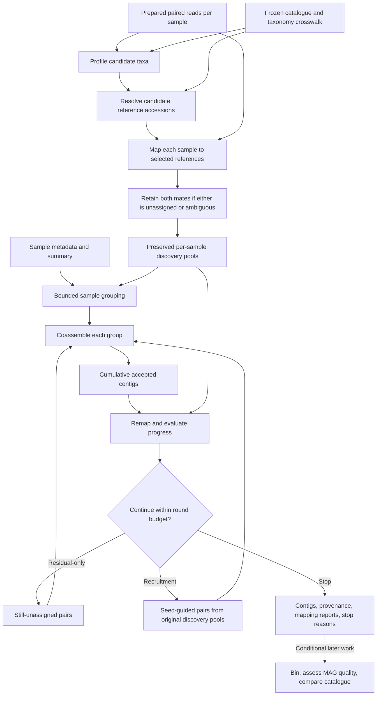

# Intended architecture

This document separates the working foundation from the system to be tested.
The owner is exploring the research idea; implementation should advance one
small feature at a time through the roadmap.

## Implemented foundation

One Rust crate exposes `validate`, `plan`, and a reserved `run` command.
Validation checks paired-read paths and sample/metadata integrity. Planning
creates deterministic metadata batches and records resource/iteration settings.
Plans explicitly remain non-executable. FASTQ contents are not read.

| Module | Present responsibility |
| --- | --- |
| `cli` | Typed command arguments, strategy selection, resource validation |
| `manifest` | Streaming TSV parsing, read-path checks, metadata summary |
| `plan` | Deterministic grouping and non-executable JSON research plans |
| `error` | Contextual diagnostics and documented exit categories |
| Binary entry point | Dispatch and JSON stdout/stderr boundary |

Table data is held in memory proportional to sample/metadata size. Biological
read volume is never held in memory. The foundation does not schedule tasks,
enforce resource budgets, cache results, fingerprint inputs, or run tools.

## Target data flow

Profiling, mapping, extraction, and assembly are logical stages; they need not
be four unrelated executables. Their implementations are chosen with the
owner. No particular tool or reference catalogue is implied by this diagram.

## Separation of concerns

Keep one crate while the prototype is small. Introduce modules for:

- Domain records: sample IDs, paired-read sets, reference IDs, groups, rounds,
  resource limits, and artifact provenance.
- Planning: sample grouping, stage dependencies, explicit iteration policies.
- Adapters: normalize selected tools' commands, outputs, versions, and failures.
- Execution: local admission scheduling, process lifecycles, cancellation,
  bounded streams, stage completion, and resume.
- Reporting: read-state accounting, metadata summaries, contig statistics,
  resource observations, and research comparisons.

Add these boundaries when implementing their first concrete behavior. Do not
build a generic plugin loader, workflow language, async runtime, or many-crate
workspace merely to reserve future extensibility.

## Input and read-state invariants

Initial inputs are already processed paired-end Illumina FASTQ or gzip FASTQ.
Later preprocessing may validate mates, trim/QC reads, and remove host reads.
Do not imply that extension/path checks establish input quality.

References are immutable catalogue entries with stable IDs, sequence digests,
taxonomy/version provenance, and a way to translate profiler output to actual
FASTA sequences. A taxon label is not necessarily a reference genome accession.
Cache mapper indexes by exact sequence/tool/parameter identity, without copying
the whole catalogue into each sample workspace.

Use explicit states:

| State | Meaning |
| --- | --- |
| Reference-assigned | Meets the selected-reference confidence policy |
| Discovery pair | Either mate is unassigned or ambiguous; retain both |
| Residual pair | A discovery pair not explained by cumulative contigs under the current policy |
| Recruited pair | A discovery pair selected using a new contig as a seed |
| Catalogue-unmatched contig | No qualifying catalogue match under a separate recorded comparison |

The last state requires comparing recovered sequences to the relevant frozen
catalogue, not just the references selected by the profiler. None establishes
a novel species/strain. The first prototype reports reference-unassigned
contigs and evaluation results without taxonomic novelty claims.

Preserve the original read files. A read identity is sample-aware and includes
mate identity; raw FASTQ names may collide across samples. Group pooling must
namespace or otherwise track those identities reversibly. Retention counts,
mapping counts, and conservation checks distinguish read pairs from individual
reads. Empty pools are valid outcomes with explicit stop reasons.

## Grouping and scaling

Metadata grouping uses exact values, sorted sample IDs, and deterministic
batches at a configurable sample cap. All selected metadata and missing-value
summaries remain available. Missing grouping values fail clearly.

Before real coassembly, add group volume estimates and a budget-aware admission
policy; a sample-count cap alone cannot predict assembler RAM. Multiple groups
from one metadata class remain separate assemblies unless explicitly combined.
The current planner neither loads nor concatenates their reads.

For future k-mer grouping, use bounded streaming sketches and avoid a mandatory
dense all-pairs matrix. Record whether sketches represent full inputs or
discovery pools, the sketch parameters, seed, distance definition, and grouping
policy. Compare against metadata and simple baselines before making it default.

## Resource model

`--threads` and `--memory-gib` describe total single-node budgets;
`--jobs` limits concurrent tasks. A scheduler must admit tasks only when their
combined reservations fit those totals. Each adapter translates its reservation
into tool-specific arguments and includes helper processes such as sorting and
compression. Reject an impossible task before launching it.

Memory reservations are estimates and admission controls, not OS hard caps.
Record observed peak usage and failures. Actual enforcement, if needed later,
must be platform-aware and explicit.

Stream FASTQ/alignment data through bounded buffers or files. Do not collect
whole subprocess outputs or a global map of all read names. Pair extraction
may require disk-backed/name-collated data to avoid an unbounded mate buffer.
Budget temporary storage and disk I/O alongside CPU/RAM.

Use tool-supported file lists or input streams for pooled reads when practical.
If an assembler needs materialized pools, write them once with preserved IDs,
account for their scratch footprint, and define safe cleanup. Avoid repeated
full copies for each iteration.

## Execution, completion, and resume

The first executor is local. Represent a stage with immutable input identities,
configuration, tool/version identity, resource reservation, declared outputs,
and a completion result. Keep this boundary small enough for an optional later
SLURM executor; do not introduce a distributed service now.

Invoke executables with argument arrays. Drain both output streams, capture
bounded logs or log files, and propagate failures from every process in a
pipeline. Cancellation must stop dependent work and reap children.

Write outputs under stage-owned partial locations, validate them, and publish
completion atomically on the same filesystem. An exit code of zero is necessary
but insufficient: expected outputs and their invariants must also pass.

Resume requires a completed stage manifest matching input content identities,
catalogue, tool versions, parameters, group membership, and upstream outputs.
Paths, timestamps, and generated group IDs alone are insufficient. Compute
large-file content digests during necessary streaming passes where feasible.
Changed inputs or configuration invalidate affected stages. Never mark partial
work as complete or silently overwrite another run.

Provenance includes the resolved configuration, sample/metadata versions,
catalogue identity, exact commands/tool versions, seeds, read-state counts,
resource observations, and stop reasons. The initial research plan is not
a resume manifest.

## Iteration

Both strategies are selected by `--iteration-strategy` and bounded by
`--max-rounds`, including the initial assembly.

- Residual-only maps discovery reads against cumulative accepted contigs and
  assembles the unexplained remainder.
- Recruitment revisits preserved original discovery pools with new contigs
  as seeds and selects supporting pairs for refinement/extension. Previous
  recruitment must not duplicate evidence or destructively consume the pool.

Keep per-round outputs and cumulative contigs distinct. Acceptance rules,
mapping confidence, recruitment thresholds, redundant-contig handling, and
measurable convergence are decided with the owner during implementation.
Stop on exhausted input, no accepted new contigs, insufficient progress, or
the round budget, recording the reason. A repeated identical residual input
must not cause an automatic infinite loop.

## Research endpoint and conditional extensions

The pilot ends at contigs, with correctness/recovery and resource measurements
against controlled baselines. An early research decision determines whether
the approach deserves more investment.

Only then prioritize additional clustering, binning, MAG quality assessment,
dereplication, catalogue comparison, broader inputs, or SLURM. MAG reporting
must distinguish assembly quality, completeness, and contamination, following
an explicit standard such as [MIMAG](https://www.nature.com/articles/nbt.3893).
Tool and threshold selections remain owner decisions.
