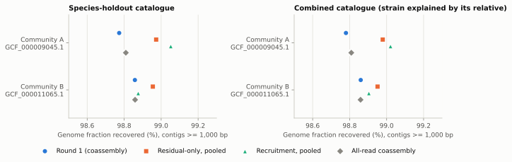
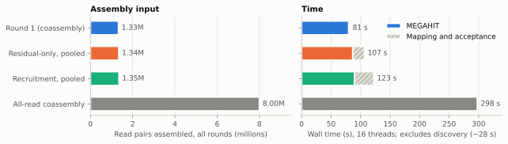
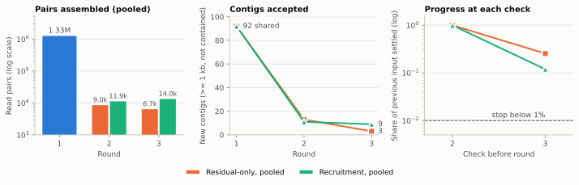
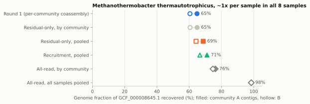

# M6: bounded iteration with both strategies

Status: owner-confirmed choices, implemented for review on
`feature/iterative-assembly`.

## Problem

M6 implements `residual-only` and `recruitment` iteration: remap discovery
pairs against cumulative accepted contigs, reassemble what they leave, keep
the original pools and every round's outputs, and stop at the round limit or
under an explicit exhausted/no-progress policy.

## Decisions

The owner chose:

- **A new `iterate` command that can combine coassemble runs.** Samples can
  be split into subsets, discovered and coassembled separately, and then
  iterated together. Combined runs need disjoint samples and discover runs
  with the same catalogue and assignment policy; anything else is refused.
- **Regrouping like coassemble, plus all and keep.** Later rounds group all
  samples of all inputs by `--metadata`/`--group-by`, `--per-sample`, or
  `--all-samples` (also added to `coassemble`), or reuse the input groups
  with `--keep-groups`. One cumulative contig set is shared by every group,
  so a genome assembled from one subset explains reads of another.
- **The pooled flow is the intended use.** Coassemble by a metadata
  criterion, then `iterate --all-samples`: the groups' contigs join one set,
  every pool is mapped to it, and all unassigned pairs are pooled into one
  assembly per round. Later rounds hold only leftovers, so `iterate` has no
  sample cap unless `--max-group-samples` is given; `--max-group-bases` is
  checked against the original pool sizes (an upper bound on any round).
- **Pools are mapped against the contigs only.** They already exclude pairs
  explained by the selected references; a pair with one mate on a reference
  and one on a contig stays unassigned.
- **One grouping for all later rounds.** A staged schedule (for example by
  site, then region, then everything) is deferred until real metadata needs
  it.
- **Accepted contigs:** at least 1,000 bp (the evaluation cutoff,
  `--min-contig-length`) and not contained in another contig. Containment
  uses minimap2 `-x asm5 -c`: one alignment covering at least 95% of the
  contained contig at identity (matches / block length) of at least 95%. A
  new contig contained in an accepted or a longer new contig is redundant;
  an accepted contig contained in a newly accepted one is superseded (it
  stays in its round's outputs but leaves the cumulative set).
- **Residual-only uses the `explained` rule:** both mates align with
  identity of at least 98% and aligned fraction of at least 90% (primary or
  secondary) to any accepted contig. MAPQ, pairing, and which contig are
  ignored: ambiguity among one's own overlapping contigs is no reason to
  reassemble. Each round checks only the previous round's remaining pairs.
- **Recruitment reassembles everything not certain.** The owner amended the
  M1 seed rule (one mate at 95% identity and 80% aligned fraction to a new
  contig): each round re-checks the group's original discovery pools and
  reassembles every pair that is not certainly explained. `certain` means
  both primaries pass 98%/90% with MAPQ of at least 20, the mates are a
  proper pair on one contig, there is no supplementary record, and no
  qualifying secondary alignment lies on another contig. Pairs at contig
  ends, across contig breaks, in overlaps, or in ambiguous placements
  therefore return with the support of new contigs; a pair can return after
  being settled if its contig is superseded.
- **Stops:** besides `--max-rounds` (default 3, the M1 value), a group stops
  when its next input is empty (`exhausted`), equals its previous input
  (`unchanged-input`), or the contigs settle less than `--min-progress`
  (default 1%) of its previous input (`insufficient-progress`), and every
  group stops when the previous round accepted no contig
  (`no-accepted-contigs`).
- **Genomes, not strains.** Reads confidently mapped to a catalogued related
  strain count as explained, so a genome whose species is in the catalogue is
  not a discovery target. The evaluator counts a genome as held out only when
  no catalogue reference shares its species (`--genomes`); other genomes
  outside the catalogue are reported as `represented_by_relative`. This
  retires the M1 related-strain stress test.
- **Recruitment stays** alongside residual-only.
- **Tests of the pooled flow:** the pilot (species and combined holdouts),
  with each community discovered and coassembled separately and then
  iterated together, both strategies, three rounds, pooled and by community;
  and a supplementary scenario with a novel genome spread thinly over all
  samples, which pooling is meant to recover.

## Behavior

| Concern | Behavior |
| --- | --- |
| Inputs | Each coassemble run must be succeeded, from discovery pools, with complete group stages. Its discover run must still match the digest recorded at coassembly, every pool is re-read against `extraction.json`, and input contigs are checked against the digest that `assembly.json` now records. |
| Task graph | `accept-r01`; then for each round, `check-rNN-GROUP` and `assemble-rNN-GROUP` per group, and `accept-rNN`. The graph is static: stages after a stop run no tools and record the stop (`carried`). |
| Check | One step per member: the mapper (the discover mappers, with `-N 50`) on the member's pool against the previous cumulative set, piped into the built-in `classify-pairs`, which streams the pool in lockstep, copies unsettled pairs verbatim into the next pool, and writes a decision per pair. Empty pools skip the mapper. Recruitment also streams the previous decisions in lockstep to measure progress and detect an unchanged input without holding read sets in memory. |
| Progress | Pairs of the group's previous input that the current contigs settle, divided by that input. For round 2 the previous input is the whole pool. |
| Assembly | MEGAHIT as in M5 on the members' kept pools, as file lists; contigs `rNN.GROUP__ID`; status `contigs`, `no-contigs`, or `skipped`. |
| Acceptance | Candidates are filtered by length, compared new-vs-new (`-X`) and new-vs-accepted with minimap2, and resolved by decreasing length then ID; `contigs.tsv` lists accepted, redundant, and superseded contigs with their containers. |
| Outputs | Per-round pools, decisions, classification and round reports, assemblies, and cumulative sets. The final contigs are the last round's `cumulative.fa`. The summary lists every group's rounds and stop. |
| Evaluation | `scripts/evaluate_assemblies.py` accepts `NAME=ITERATE_DIR[@ROUND]`: contigs are assigned to communities through the group that assembled them, and assembly inputs count every round, including the input coassemblies. |

## Pilot results

Eight samples, 16 threads, 64 GiB. For each catalogue, each community was
discovered (Sylph, Strobealign) and coassembled (`--all-samples`) on its
own; both coassemblies were then iterated together for at most three rounds
with each strategy, with all leftovers pooled (`--all-samples`, the owner's
flow) and, for comparison, kept per community. MetaQUAST 5.3.0 compared, per
community and with a 1,000 bp cutoff, round 1 (the coassemblies after
acceptance), the final contig sets, and all-read coassembly by community.
Pooled contigs are evaluated with every community; inputs count every
round. Held-out genomes are species absent from the catalogue. Results:
[m6-iteration.json](../../experiments/pilot/m6-iteration.json); figures from
`scripts/plot_m6_iteration.py`.

### Pilot species holdout

| Arm | Pairs assembled | MEGAHIT | Mapping and acceptance | Held-out recovered (A / B) | Misassemblies (A / B) |
| --- | ---: | ---: | ---: | ---: | ---: |
| Round 1 | 1.33M | 80 s | 1 s | 98.77% / 98.86% | 0 / 1 |
| Residual-only, pooled | 1.34M | 87 s | 20 s | 98.97% / 98.96% | 1 / 2 |
| Recruitment, pooled | 1.35M | 90 s | 33 s | 99.05% / 98.88% | 3 / 1 |
| Residual-only, by community | 1.34M | 90 s | 18 s | 98.97% / 98.97% | 1 / 1 |
| Recruitment, by community | 1.35M | 96 s | 36 s | 99.08% / 98.88% | 3 / 1 |
| All-read coassembly | 8.00M | 298 s | — | 98.81% / 98.86% | 7 / 7 |

Every discovery arm passes the M1 gate (83.1–83.4% fewer pairs; held-out
recovery changes from −0.04 to +0.27 points against all-read assembly), with
206 MB peak RSS against 971 MB. Pooling changes little here because each
held-out species lives in one community. Round 1 contigs explained 99.3% of
the pools (99.1% certain); the pooled round 2 assembled 9.0k pairs
(residual-only) or 11.9k (recruitment) and accepted 13 or 11 contigs.
Recruitment kept more pairs in round 3 (14.0k): contigs that overlap
earlier ones make settled pairs ambiguous again, as its rule intends. No
group stopped early; progress at the last check was 25% and 12%.

The combined catalogue adds the strain W3110, whose reads discovery assigned
to its catalogued relative K-12 MG1655; by the owner's genome-level decision
they are explained. Its held-out species agree within 0.05 points and every
arm passes the gate.

### Split-genome scenario

`scripts/prepare_split_scenario.py` appended 6,000 simulated pairs of
Methanothermobacter thermautotrophicus (GCF_000008645.1, about 1x) to copies
of all eight samples and removed it from the species-holdout catalogue: about
4x per community, 8x pooled. Discovery kept every one of its pairs.

| Arm | Pairs assembled | Thin genome recovered (A / B contigs) | Misassemblies (A / B) |
| --- | ---: | ---: | ---: |
| Round 1 | 1.38M | 64.8% / 60.5% | 1 / 5 |
| Residual-only, by community | 1.40M | 64.9% / 60.5% | 2 / 5 |
| Residual-only, pooled | 1.40M | 68.7% / 64.3% | 2 / 6 |
| Recruitment, pooled | 1.44M | 71.0% / 66.6% | 7 / 8 |
| All-read, by community | 8.05M | 76.2% / 74.7% | 8 / 11 |
| All-read, all samples pooled | 8.05M | 98.5% / 98.5% | 12 / 11 |

Pooling helps where keeping communities apart does not: residual-only adds
about 4 points by pooling and nothing by community, and recruitment adds about
6. But pooled iteration stays far below a pooled assembly (98.5%). Round 1
contigs, fragmented at 4x, explain their reads, so the pooled rounds see only
the reads in the gaps and cannot rebuild the genome at 8x; recruitment
returns the pairs at contig ends and does somewhat better. Against all-read
coassembly by community, every discovery arm loses 5–14 points on this genome
and fails the gate; round 1 itself recovers 11–14 points less than all-read
coassembly of the same groups although discovery kept every pair, which is
MEGAHIT's behavior on the smaller input, not read removal.

On this pilot, iteration costs 25–50 s and 1–5% more assembly input. It adds
0.1–0.3 points for well-covered novel species, and 4–6 points for a genome
spread thinly across groups when leftovers are pooled. Recovering such a
genome fully needs its reads assembled together, which accepting
fragmented round-1 contigs prevents; this is an M7 question.

## Alternatives considered

- Extending `coassemble` with the existing flags: simpler, but cannot combine
  separately produced coassemblies.
- The M1 seed rule for recruitment: replaced by the owner's rule above.
- Accepting every contig, or no redundancy check: recruitment would re-add
  near-duplicates of earlier contigs every round.
- Structural stops only: the owner added the progress threshold.

## Limitations and revisit conditions

- `asm5` targets near-identical sequence, so in practice containment merges
  contigs that are about 99% identical or more; strain variants at 95–99%
  may stay as separate contigs. Revisit with strain-resolved truth.
- Containment uses one alignment per contig pair; a contig contained only in
  pieces (for example across a repeat) is kept.
- Thresholds and the 1% progress default are provisional, not benchmarked.
- The mapper index memory estimate is provisional (reference size × 32,
  allowing the set to double).
- The progress measure counts pairs, not bases or new sequence.

## Validation

Unit tests cover both pair rules and their reasons, structural errors,
lockstep pool classification with previous decisions (progress, unchanged
input, mismatches), PAF containment, redundancy and supersession, cumulative
rewriting, all-samples grouping, and CLI validation. Fake-tool integration
tests cover combining two coassembly runs with metadata regrouping, each stop
reason, residual pools, empty pools, recruitment against original pools and
previous decisions, per-sample and all-sample grouping, refusals (repeated
samples, other catalogues, changed contigs, discover runs, or pools,
unfinished runs, missing tools), and a failed check. An opt-in test runs real
Sylph, Strobealign, MEGAHIT, and minimap2 with both strategies. Evaluator
tests cover iterate arms (including `@ROUND`), contig origins, pooled inputs
split by sample, and species-level held-out genomes.
