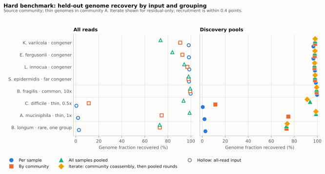
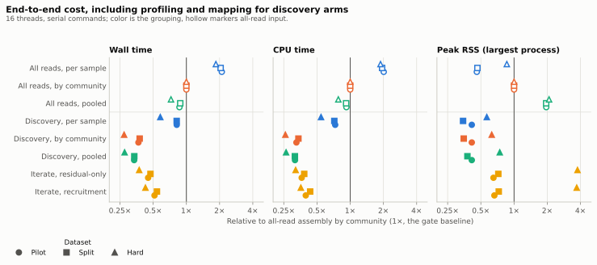
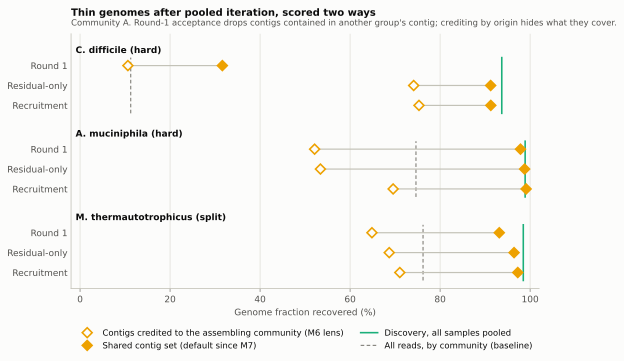

# M7: research decision on the contig pilot

Status: owner decision **continue** (2026-11-14), with the choices under
[Decision](#decision); experiments on `research/contig-pilot-evaluation`.

## Question

Is catalogue-based read subtraction followed by coassembly of the residual
pools worth developing further? M7 tests reference subtraction, sample
grouping, and iteration separately, and includes harder holdouts than the M1
pilot. Strain mixing is no longer a target: the owner's M6 genome-level
decision counts reads explained by a catalogued same-species relative as
explained.

## Criteria (owner-agreed before the runs)

- **Continue** if, on every dataset, the best discovery arm:
  - loses at most 5 points of genome fraction per held-out genome against
    grouped all-read assembly;
  - assembles at least 50% fewer pairs;
  - has lower end-to-end wall time and peak RAM, including profiling and
    mapping.
- **Revise** if failures are confined to identifiable cases with a plausible
  fix.
- **Stop** if losses are broad or end-to-end cost is not lower.
- Budget: minimal, about 2 hours of compute. Cost is wall time, CPU time, and
  peak RAM per arm, measured with `/usr/bin/time`.

## Design

**Datasets.** Synthetic ART reads (HS25, 150 bp, 350 ± 50 bp fragments)
from frozen RefSeq genomes:

| Dataset | Samples | Groups | Held-out genomes | Seed |
| --- | --- | --- | --- | --- |
| Pilot (M1 species holdout) | 8 × 1M pairs | 2 communities | one species per community | 20261113 |
| Split (M6) | Pilot + 6,000 pairs per sample | 2 communities | adds *M. thermautotrophicus* at ~1x in every sample | 20261113 |
| Hard ([design](../../experiments/m7-hard/README.md)) | 12 × 500k pairs | 3 communities | 8 novel genomes | 20261114 |

The hard benchmark's novel genomes fall into four classes:

- **Congeners**, each in one community at 5x. Their catalogued relatives are
  in every sample at 5x:
  - *K. variicola*, ~94.7% ANI to *K. pneumoniae*;
  - *E. fergusonii*, ~92.6% ANI over 64% of its length, to *E. coli*;
  - *L. innocua*, ~88.9% ANI to *L. monocytogenes*;
  - *S. epidermidis*, which aligns to *S. aureus* over only 11% of its length.
- **Common:** *B. fragilis* at 10x in one community.
- **Thin:** *C. difficile* at 0.5x and *A. muciniphila* at 1x in every sample.
- **Rare:** *B. longum* at 1x in one community.

**Arms.** For each dataset:

- **Factorial:** input (all reads, or discovery pools) × grouping:
  - per sample;
  - metadata communities;
  - all samples pooled.
- **Iteration:** `iterate --all-samples --max-rounds 3` on the grouped
  discovery coassembly, with each strategy (residual-only and recruitment).

| Arm | End-to-end cost counts |
| --- | --- |
| Discovery, any grouping | `discover` + `coassemble` |
| Iterate | `discover` + grouped `coassemble` + `iterate` |
| All-read, any grouping | `assemble-reads` |

The gate baseline is grouped all-read assembly.

**Execution.**
- Every command ran serially at 16 threads and 64 GiB (`--jobs 4` for
  `discover`) under `/usr/bin/time -v`, from commit 67d293c.
- Tools: Sylph 1.0.0, Strobealign 0.20.0, MEGAHIT 1.2.9, minimap2 2.31, and
  MetaQUAST 5.3.0 with a 1,000 bp cutoff.
- Hardware: Intel Xeon Gold 5416S, 64 logical CPUs, 503 GiB.
- Commands are in [experiments/m7/](../../experiments/m7/), including
  `run.sh`, the evaluation scripts, `collect.py`, and `plot.py`. Results
  are in [results.json](../../experiments/m7/results.json); figures are in
  [experiments/m7/figures/](../../experiments/m7/figures/).
- Runs took 2 h 15 min and evaluation about 15 min, over the 2-hour budget.

**Evaluation lenses.** Three MetaQUAST views were used:

1. **Per community (agreed gate).** Each arm's contigs come from the groups
   that contain a community's samples. Each held-out genome is scored in the
   community that holds its reads. An iterate run's whole contig set is
   scored with every community. That became the evaluator's default by owner
   decision, for the reasons under Iteration.
2. **Iterate contigs attributed to their assembling group (`--origin-arm`).**
   This is the lens of the M6 results, kept to document the artifact
   described under Iteration.
3. **All genomes, for correctness.** Every contig of an arm is aligned
   against every source genome of the dataset. Under the per-community lens,
   pooled contigs of a congener confined to community B align to its
   relative in community A at ~92% identity. That inflates mismatches and
   misassemblies.

## Results

### Gate

The best discovery arm on every dataset is discovery with all samples
pooled. In the table, "worst loss" is the largest per-genome loss against
grouped all-read assembly, and the last three columns are cost ratios
against grouped all-read assembly.

| Dataset | Fewer pairs | Worst loss (points) | Wall | CPU | Peak RSS | Verdict |
| --- | ---: | ---: | ---: | ---: | ---: | --- |
| Pilot | 83.4% | 0.02 | 0.34 | 0.32 | 0.41 | pass |
| Split | 82.9% | 0.02 | 0.34 | 0.32 | 0.38 | pass |
| Hard | 67.7% | 0.00 | 0.28 | 0.26 | 0.74 | pass |

Grouped discovery also passes on every dataset; its worst loss is 0.14
points. Peak RSS ratios: 0.41, 0.35, and 0.63. Per-sample discovery fails
on the split and hard datasets: thin and rare genomes need more than one
sample. Iteration is discussed below.

### Held-out recovery on the hard benchmark

Genome fraction (%) in the source community. Thin genomes are shown in
community A; the other communities agree within 1.3 points.

| Genome (class) | All reads: per sample / grouped / pooled | Discovery: per sample / grouped / pooled | Iterate: residual / recruitment |
| --- | ---: | ---: | ---: |
| *K. variicola* (congener) | 98.1 / 90.8 / 73.7 | 96.6 / 98.0 / 98.0 | 98.1 / 98.3 |
| *E. fergusonii* (congener) | 98.3 / 92.7 / 83.9 | 96.6 / 97.7 / 97.8 | 97.9 / 97.9 |
| *L. innocua* (congener) | 98.6 / 96.9 / 94.2 | 97.9 / 97.6 / 97.5 | 97.7 / 97.6 |
| *S. epidermidis* (far congener) | 98.4 / 98.0 / 98.0 | 98.7 / 98.0 / 98.0 | 98.1 / 98.3 |
| *B. fragilis* (common, 10x) | 99.8 / 99.4 / 99.4 | 99.8 / 99.4 / 99.4 | 99.5 / 99.4 |
| *C. difficile* (thin, 0.5x) | 0.6 / 11.3 / 93.7 | 0.5 / 11.4 / 93.7 | 91.2 / 91.3 |
| *A. muciniphila* (thin, 1x) | 2.0 / 74.6 / 98.9 | 2.0 / 74.8 / 98.9 | 98.8 / 99.1 |
| *B. longum* (rare, 1x, one group) | 2.7 / 73.0 / 72.9 | 2.8 / 73.3 / 73.2 | 73.9 / 73.7 |

On the pilot, every arm recovers both held-out species at 98.8–99.4%. On
the split scenario, the thin genome reaches:

| Split arm | Thin genome recovered (A / B) |
| --- | ---: |
| Per sample | 2.0 / 1.9 |
| Grouped, either input | 76.2 / 74.7 |
| Pooled, either input | 98.5 |
| Iterate, residual-only | 96.4 |
| Iterate, recruitment | 97.3 |

### Factors

- **Reference subtraction did not reduce held-out recovery, except slightly
  for congeners assembled per sample. It improved close congeners when
  samples were combined.** At equal grouping, discovery and all-read arms
  agree within 0.3 points on non-congeners. Assembled per sample, congeners
  lose 0.7–1.7 points, consistent with their false removal. Congeners gain
  against grouped all-read assembly: *K. variicola* +7.3 and
  *E. fergusonii* +5.1. Against pooled
  all-read assembly they gain +24.3 and +13.9. Their relatives' reads are
  removed, so MEGAHIT no longer merges or breaks the two genomes, even though
  discovery falsely removed 7.2% and 5.7% of the congeners' own pairs.
  Subtraction cuts assembly input by 68–83%.
- **Grouping decides thin and rare genomes.** Per-sample assembly loses
  them; per-community assembly recovers 11–76%; pooling recovers 94–99%.
  Discovery makes pooling affordable: pooled discovery costs about the same
  as grouped discovery. Against pooled all-read assembly it uses 0.38x the
  wall time and 0.36x the peak RSS on the hard benchmark. The rare genome is
  limited by its coverage (4x within one community), not by subtraction or
  grouping.
- **Iteration recovers what grouping lost, but does not beat one-shot
  pooling.** Starting from the grouped coassemblies, iteration lifts
  *C. difficile* from 31.6% (the accepted round-1 union) to 91.2–91.3%.
  The split genome goes from 93.1% to 96.4–97.3%. Pooled discovery reaches
  93.7% and 98.5% for 0.6–0.75x of iteration's end-to-end wall time.

### Discovery pools

| | Pilot | Split | Hard |
| --- | ---: | ---: | ---: |
| Retained pairs from genomes absent from the catalogue | 99.35% | 99.37% | 99.32% |
| Retained pairs from catalogued genomes selected for that sample | 0.65% | 0.63% | 0.68% |
| Retained pairs from catalogued genomes not selected | 0 | 0 | 0 |
| Largest residual contamination (catalogued genome's pairs retained) | 0.38% | 0.38% | 0.74% (*E. coli*) |

Sylph selected every catalogued genome present in every sample, including
*M. smithii* at 0.5x. The categories come from read-name truth; the pipeline
itself sees only "unassigned to the selected references".

Pairs of held-out genomes falsely removed (assigned to a catalogued
reference):

| Genome | Falsely removed |
| --- | ---: |
| *K. variicola* | 7.2% |
| *E. fergusonii* | 5.7% |
| *L. innocua* | 2.7% |
| *S. epidermidis* | 0.4% |
| *C. difficile* | 0.13% |
| Others, and pilot held-out species | ≤ 0.002% |

At 5x these losses did not lower recovery. They could at lower congener
coverage.

### Contig correctness (all-genome lens)

| Hard benchmark arm | Misassemblies | Per assembled Mbp | Mismatches per 100 kbp | N50 |
| --- | ---: | ---: | ---: | ---: |
| All reads, grouped | 180 | 1.65 | 76.0 | 17.8 kb |
| All reads, pooled | 50 | 0.85 | 27.8 | 34.0 kb |
| All reads, per sample | 676 | 2.78 | 265.3 | 3.8 kb |
| Discovery, grouped | 33 | 1.11 | 31.4 | 61.9 kb |
| Discovery, pooled | 15 | 0.52 | 19.2 | 88.5 kb |
| Iterate, residual-only / recruitment | 37 / 41 | 1.20 / 1.33 | 29.8 / 30.8 | 52.8 / 53.3 kb |

No arm has unaligned contigs except all-read per-sample (6.7 kb). On the
pilot and split, pooled and grouped arms have 1–19 misassemblies, and
per-sample all-read arms 69–73. Discovery arms assemble only the residual,
so their combined genome fraction (34–46%) is not comparable to the all-read
arms (90–95%).

### Cost

End-to-end, at 16 threads. RSS is the largest single process.

| Arm | Hard: wall / CPU / RSS | Pilot: wall / CPU / RSS | Split: wall / CPU / RSS |
| --- | ---: | ---: | ---: |
| All reads, grouped | 676 s / 8,425 s / 0.64 GiB | 296 s / 3,512 s / 0.90 GiB | 305 s / 3,692 s / 0.91 GiB |
| All reads, pooled | 490 s / 6,573 s / 1.34 GiB | 256 s / 3,242 s / 1.77 GiB | 268 s / 3,389 s / 1.78 GiB |
| All reads, per sample | 1,251 s / 15,860 s / 0.55 GiB | 620 s / 7,067 s / 0.41 GiB | 624 s / 7,183 s / 0.42 GiB |
| Discovery, grouped | 184 s / 2,177 s / 0.40 GiB | 109 s / 1,142 s / 0.37 GiB | 115 s / 1,252 s / 0.32 GiB |
| Discovery, pooled | 186 s / 2,209 s / 0.48 GiB | 100 s / 1,109 s / 0.37 GiB | 103 s / 1,164 s / 0.34 GiB |
| Discovery, per sample | 392 s / 4,582 s / 0.36 GiB | 242 s / 2,566 s / 0.37 GiB | 249 s / 2,649 s / 0.31 GiB |
| Iterate, residual-only | 252 s / 2,696 s / 2.42 GiB | 133 s / 1,275 s / 0.59 GiB | 144 s / 1,414 s / 0.65 GiB |
| Iterate, recruitment | 288 s / 3,006 s / 2.38 GiB | 152 s / 1,388 s / 0.60 GiB | 165 s / 1,600 s / 0.66 GiB |

Profiling and mapping (`discover`) take 26–27 s of each discovery arm. Peak scratch is at
most 1.6 GB for every arm.

### Iteration, and a correction to M6

When each iterate contig is credited only to the community whose group
assembled it, which is the M6 lens, both iterate arms fail the gate on the
split and hard datasets:

- *A. muciniphila* loses 21.2 points (residual-only) and 5.1
  (recruitment).
- The split genome loses 7.5–10.4 points.

This is an artifact of the lens. Round-1 acceptance drops a contig that is
contained in another group's contig: 1,137 of 5,107 candidates on the hard
benchmark. The evaluator credits each round-1 contig only to the community
that assembled it, so community A loses regions that a community B contig
still covers. Yet every pool is mapped to the one shared set. Measured
directly, the final set covers 99% of *A. muciniphila* and 91% of
*C. difficile*. With the whole set scored for every community (now the
default), both iterate arms pass recovery on every dataset, with worst
losses at or below 0.

The same artifact produced two conclusions in
[the M6 record](0006-iterative-assembly.md):

- **"Fragmented round-1 contigs absorb its reads"; pooled iteration stays
  far below a pooled assembly.** Evaluated as shared sets, the M6 split runs
  recover the thin genome at:

  | Arm | Recovered |
  | --- | ---: |
  | Round 1 | 93.1% |
  | Residual-only | 96.4% |
  | Recruitment | 97.3% |
  | Pooled all-read assembly | 98.5% |

- **Round 1 recovers 11–14 points less than grouped all-read assembly.**
  Grouped discovery coassembly matches grouped all-read assembly: 76.2% /
  74.7% for both.

The M6 record now carries a correction note.

Iteration fails the cost check on the hard benchmark only:

- Its round-1 containment (`minimap2 -x asm5 -c -N 50 -X`, all-against-all
  over 5,107 contigs, 30 Mbp) peaks at 2.4 GB for 2 s. At this scale that
  exceeds MEGAHIT's 0.64 GB on the grouped all-read input.
- The engine's sampled RSS missed this spike in one of the two runs (0.37
  vs 2.05 GiB for identical input). `/usr/bin/time` caught it in both.

## Decision

**Continue** (owner, 2026-11-14). On all three datasets the best discovery
arm (pooled discovery coassembly) meets every agreed criterion. Its worst held-out loss is
0.02 points, and it assembles 68–83% fewer pairs. It costs 0.26–0.34x the
CPU and 0.28–0.34x the wall time of grouped all-read assembly, with lower
peak RSS. It also assembles congeners more accurately than any all-read arm.
Grouped discovery also passes.

The owner also decided:

- **Compare with existing methods at a reasonable point.** This is roadmap
  M15. Methods, datasets, and metrics are chosen with the owner.
- **Recommended flow.** `discover` then `coassemble --all-samples` is the
  documented default. Metadata grouping and iteration remain fallbacks for
  when one pooled assembly is too large; iteration recovers most of what
  grouping loses. The CLI defaults are unchanged: `coassemble` still
  requires a grouping and splits groups at 32 samples unless
  `--max-group-samples` is raised.
- **Evaluate iterate runs as shared sets.** This is now the default of
  `scripts/evaluate_assemblies.py`. `--origin-arm` restores attribution by
  assembling group, the M6 lens.

Open findings, not yet scheduled:

1. **Bound containment memory.** Containment is the identifiable cost
   failure. Options: batch candidates, use fewer threads, or screen with
   approximate mapping before `-c`. The engine's sampled RSS should also
   catch short spikes.
2. **Test at scale before stronger claims.** At 6–8M pairs, RAM is
   dominated by fixed costs (catalogue index, minimap2 alignment), not data
   volume. Four concurrent mapping jobs total up to 0.9–1.2 GiB, above
   MEGAHIT's peak on two datasets. Whether pooled discovery assembly stays
   within memory on real cohorts is the open question for the pooled flow.
   M15 requires a realistic-scale dataset.

## Limitations

- Synthetic reads from one seed per dataset, a small catalogue, and a clean
  truth set. There are no replicates, so differences under about 1 point are
  noise.
- Genome fraction from MetaQUAST at 1 kb measures recovery, not binning. No
  MAG, novelty, or real-data claims are made.
- Congeners were tested at 5x only. Strain mixing is out of scope by owner
  decision.
- The gate is relative to grouped all-read assembly, which itself misses
  thin genomes. Pooled all-read assembly is a stronger baseline, and pooled
  discovery matches or beats it on every held-out genome.
- Containment and progress thresholds remain the provisional M6 values.

## Validation

- A unit test covers shared iterate arms and `--origin-arm`.
- Other arms are evaluated as before. The M6 iterate figures reproduce with
  `--origin-arm`.
- All 24 runs and all evaluations exited 0. Evaluations were re-run with the
  new default, and the shared-set figures are unchanged.
- `collect.py` asserts that `results.json` contains no local paths.
